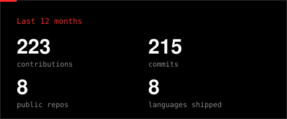
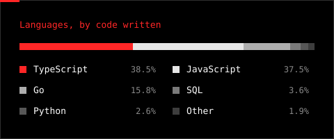

 

 

I study engineering at MIT Manipal and business at IIM Bangalore. I build both halves of a product: software that holds up under load, and a clear case for why it should exist. My work leans to the backend (gateways, ledgers, analytics pipelines), with an interface on top that someone outside engineering can actually use.

Away from the editor, I head business development and PR at MTTN, Manipal's student media network, which has 25k+ followers.

 

## Selected work

<table>
  <tr>
    <td width="76" valign="top" align="center">
      
    </td>
    <td valign="top">
      <b><a href="https://github.com/TECHMINEs/Relay">Relay</a></b> &nbsp;·&nbsp; fault-tolerant LLM gateway 
      A drop-in, OpenAI-compatible gateway in Go. It routes requests by weight across providers, with a circuit breaker and half-open probes per provider, jittered retries, and a Redis Lua token bucket for rate limits and daily token quotas. Every request is metered in Prometheus. 
      <code>257 req/s</code> &nbsp; <code>3.4 ms p99</code> &nbsp; <code>0 failed / 20,594</code> &nbsp;local k6 run against a mock provider 
      Go · Redis · PostgreSQL · Prometheus · Grafana · Next.js 
      <a href="https://techmines.github.io/Relay/">Live walkthrough</a> &nbsp;·&nbsp; <a href="https://github.com/TECHMINEs/Relay/blob/main/loadtest/results/steady.json">k6 results</a>
    </td>
  </tr>
  <tr>
    <td width="76" valign="top" align="center">
      
    </td>
    <td valign="top">
      <b><a href="https://github.com/TECHMINEs/ChainProof">ChainProof</a></b> &nbsp;·&nbsp; chain of custody for forensic evidence 
      Every hand-off from seizure to courtroom is hashed, pinned to IPFS and anchored on Polygon. A tampered record fails a three-way check (database, IPFS, chain), which anyone can run from the public verify portal. Transfers carry Groth16 proofs. 
      Next.js 14 · TypeScript · PostgreSQL · Prisma · Solidity · IPFS · Redis 
      <a href="https://techmines.github.io/ChainProof/">Live demo</a> &nbsp;·&nbsp; <a href="https://github.com/TECHMINEs/ChainProof">Source</a>
    </td>
  </tr>
  <tr>
    <td width="76" valign="top" align="center">
      
    </td>
    <td valign="top">
      <b><a href="https://github.com/TECHMINEs/DevPulse">DevPulse</a></b> &nbsp;·&nbsp; developer wellness analytics 
      Reads your GitHub history for signs of burnout. Night and weekend commits, sprint-and-crash cycles and streaks add up to a 0–100 wellness score, with a 7-day forecast from a scikit-learn model served by FastAPI. Includes live sync, team views, PDF reports and a Monday digest. 
      React 18 · Express · FastAPI · scikit-learn · Socket.io 
      <a href="https://techmines.github.io/DevPulse/">Live demo</a> &nbsp;·&nbsp; <a href="https://github.com/TECHMINEs/DevPulse">Source</a>
    </td>
  </tr>
  <tr>
    <td width="76" valign="top" align="center">
      
    </td>
    <td valign="top">
      <b><a href="https://github.com/TECHMINEs/Nexora">Nexora</a></b> &nbsp;·&nbsp; pre-disaster resilience for industrial sites 
      Models how floods, cyclones, toxic releases and grid outages would hit a facility: exposed assets, dependency chains, losses, insurance gaps and response access. Every number traces back to its source, and 377 golden assertions check the engines. It runs on synthetic facility data. 
      TypeScript (strict) · Next.js 14 · React · Tailwind · Radix UI 
      <a href="https://techmines.github.io/Nexora/">Live demo</a> &nbsp;·&nbsp; <a href="https://github.com/TECHMINEs/Nexora">Source</a>
    </td>
  </tr>
  <tr>
    <td width="76" valign="top" align="center">
      
    </td>
    <td valign="top">
      <b><a href="https://github.com/TECHMINEs/AutoLine">AutoLine</a></b> &nbsp;·&nbsp; car manufacturing operations 
      One control room for a vehicle plant, covering production output, parts inventory, line-side consumption and quality testing, with views for admins, managers and operators. It started on Oracle SQL as a Database Systems project and now runs on SQLite through an Oracle-dialect translation layer. 
      React 19 · Express 5 · Oracle SQL → SQLite · Tailwind 
      <a href="https://techmines.github.io/AutoLine/">Live demo</a> &nbsp;·&nbsp; <a href="https://github.com/TECHMINEs/AutoLine">Source</a>
    </td>
  </tr>
</table>

 

## The long version

<a href="https://techmines.github.io"><b>techmines.github.io</b></a> has live demos of all five projects, plus a few things I built for fun: a Walkman that actually plays music, a phone handset you can pick up, and a logo hanging by a cord you can throw around. It's black and red with square corners, tuned down to the pixel.

 

## Stack

  
  
  
  
  
  

  
  
  
  
  
  
  
  

 

## By the numbers

  
  

Both cards are drawn by <a href="scripts/cards.mjs">a small script</a> from the GitHub API and refresh every night.

  

Open to internships and collaborations.

  

